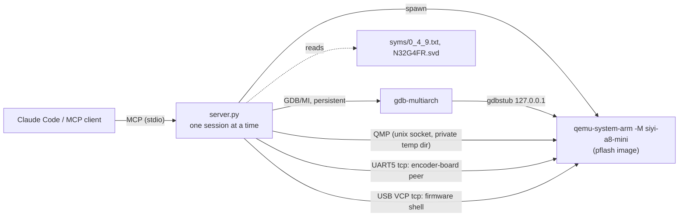

# qemu-debug MCP server

`server.py` lets Claude Code, or any other MCP client, debug the SIYI A8 mini
gimbal firmware on QEMU's `siyi-a8-mini` machine. It uses only the Python
standard library (MCP over stdio, its own GDB/MI parser) and needs
`build/qemu-system-arm`, `build/qemu-img` and `gdb-multiarch`.



## Setup

You need a QEMU built from
[qemu-n32g4fr](https://github.com/yshestakov/qemu-n32g4fr) (branch
`feat/n32g4fr_soc`, which adds the `siyi-a8-mini` machine), a checkout of
[siyi_a8_mini_re](https://gitlab.com/Ostrovskyi_Volodymyr/siyi_a8_mini_re)
(protocol v2 module and `N32G4FR.svd`), `gdb-multiarch`, and the firmware
files, which are not in this repository: `a8-mini-gimbal-<ver>.bin` and,
for booting through the bootloader, `bootloader.bin` dumped from a device.

```sh
claude mcp add qemu-debug \
  -e QEMU_BUILD=/abs/path/qemu-n32g4fr/build \
  -e SIYI_RE=/abs/path/siyi_a8_mini_re \
  -e QEMU_MCP_FIRMWARE=/abs/path/firmware-dir \
  -- python3 /abs/path/qemu_mcp/server.py
```

| Variable | Meaning |
|---|---|
| `QEMU_BUILD` | QEMU build dir (`qemu-system-arm`, `qemu-img`); or `QEMU_BIN`/`QEMU_IMG` |
| `GDB_BIN` | gdb with ARM support (default `gdb-multiarch`) |
| `QEMU_MCP_FIRMWARE` | Dir with `a8-mini-gimbal-<ver>.bin` and `bootloader.bin` |
| `SIYI_RE` | siyi_a8_mini_re checkout |
| `N32G4FR_SVD` | SVD file (default `$SIYI_RE/firmware/ghidra/N32G4FR.svd`) |
| `QEMU_MCP_RUNS` | Run directories (default `./runs`) |

Restart Claude Code afterwards; `/mcp` shows the server. The tools appear as
`mcp__qemu-debug__<tool>`. Missing dependencies are reported by
`qemu_start`.

**Agent skill:** [`skills/qemu-mcp/SKILL.md`](skills/qemu-mcp/SKILL.md)
teaches a coding agent how to install and use the server (workflows, tool
reference, troubleshooting). For Claude Code, copy or link it into
`.claude/skills/qemu-mcp/` of your project or `~/.claude/skills/qemu-mcp/`.

To try it without an MCP client, use `mcp_call.py`, which runs each tool
call given as an argument (same environment variables):

```sh
python3 mcp_call.py --list
python3 mcp_call.py 'qemu_start image=0_4_9' 'break_add location=SystemInit' \
    run_continue regs 'disas count=8' qemu_stop
```

## Tools

| Group | Tools |
|---|---|
| Session | `qemu_start`, `qemu_stop`, `qemu_status`, `qemu_reset` |
| Breakpoints | `break_add`, `watch_add`, `break_list`, `break_delete` |
| Run control | `run_continue`, `run_wait`, `run_interrupt`, `run_step`, `reverse_step`, `reverse_continue` |
| Inspect | `regs`, `reg_write`, `mem_read`, `mem_write`, `disas`, `backtrace`, `fault_info`, `svd`, `sym_lookup`, `gdb_command` |
| Board | `sensor_get`, `sensor_set`, `link_frames`, `link_send`, `shell`, `uart_output`, `qemu_log` |

`qemu_start` takes these options:
- `image`: `0_4_3`, `0_4_9` (the default) or `0_4_12`, or a path to a raw
  flash image.
- `bootloader`: `true` (the default) boots the real `bootloader.bin` from
  `0x08000000`, with the app-valid flag set. `false` gives a zeroed
  bootloader area and VTOR preset to `0x08003800`.
- `halted`: `true` by default.
- `uid` / `ucid`, `icount`, `mode`, `recording`, `auto_handshake`,
  `camera_fw`, `debug_flags`.

Flash starts fresh for every session.

## Design points

- **Non-blocking run control.** `run_continue` returns the stop (reason, pc,
  lr, sp, the active exception) or `running` after `timeout_s` (default 5,
  maximum 120 seconds). Follow up with `run_wait` or `run_interrupt`.
  Memory, register, `svd` and `disas` tools refuse to run while the target
  is running. `shell`, `link_frames` and `sensor_set` are meant for a
  running target.
- **Symbols.** The ELFs carry no symbols, so the server resolves names
  itself. `syms/0_4_9.txt` is the Ghidra export: 1112 functions plus
  labels. Every image also has landmarks: `bootloader_reset`,
  `Reset_Handler`, `SystemInit`, `SystemInit_return`, `__main`,
  `dma_wait_loop`. Locations accept `0x...`, `name` or `name+0x10`, and the
  server's output shows `<name+off>`. Add `syms/<version>.txt`, in the same
  format, to support other versions.
- **No frame info.** `backtrace` combines gdb's unwind, decoding of the
  exception frame when `lr` holds an EXC_RETURN value, and a stack scan
  for return addresses that follow a BL/BLX. `fault_info` decodes
  CFSR/HFSR/MMFAR/BFAR and ICSR.
- **Determinism.**
  - `icount=auto` (or a shift value) makes runs repeatable.
  - `mode=record` with `recording=<name>` records into
    `runs/rr-<name>/`. The flash is stored as qcow2 behind `blkreplay`,
    with a snapshot named `init`.
  - `mode=replay` with the same name re-runs the recorded configuration
    and enables `reverse_step` and `reverse_continue`.
  - In replay, serial input comes from the recording, so `link_send`,
    `shell` and `sensor_set` are disabled. Sensor changes and resets are
    not recorded, so record mode refuses them too.
  - When the replay passes the end of the recording, QEMU exits and the
    tools say so.
- **Security.**
  - There are no free-form QEMU arguments and no raw QMP or HMP access.
    HMP's `migrate exec:` and `pmemsave` could run commands or write host
    files.
  - The gdbstub and the chardevs listen on 127.0.0.1. QMP is a unix socket
    in a private (0700) temporary directory.
  - gdb runs with `-nx`, auto-load off and history saving off.
  - `gdb_command` accepts only read-only commands (`x`, `print`, `info`,
    `disassemble`, …) and rejects `$_shell` and newlines.
  - Breakpoint conditions are checked the same way.
  - Child processes die with the server (PDEATHSIG), and `qemu_stop`
    quits QEMU through QMP.

## Files

- **Run directories:** `runs/current/` holds the last normal session:
  `qemu.log` (`-d` output), `qemu.stderr`, `uart{1-4,6,7}.log`, and
  `flash.bin`. Each recording has its own `runs/rr-<name>/`.
- **Images:** `runs/images/` caches the generated flash images and ELFs.
- **`gdb_svd.py`:** the SVD parser, also usable as a gdb plugin
  (`source gdb_svd.py`, then `svd RCC`).
- **Symbols:** `syms/` holds the per-version symbol files.

## Verified

- **Breakpoints and stepping:** the bootloader → `Reset_Handler` →
  `SystemInit` → `dma_wait_loop` walk; interrupt, step and step-over.
- **Watchpoints:** a write watchpoint on the handshake state byte stopped
  in `FUN_08033c70`, the 6b/13 handler.
- **Board I/O:** `svd`, `link_frames`, `link_send`, `shell sys`, and
  `sensor_set`/`sensor_get` all work.
- **Watchdog:** stubbing out the 0.4.3 feed (`mem_write 0x080111A0 7047`)
  produces `WATCHDOG`/`RESET` QMP events in `qemu_status`.
- **Record/replay:** replay stops at the same breakpoint with identical
  registers, and `reverse_step` and `reverse_continue` work.

Two QEMU bugs had to be fixed for this; both are committed on the branch:
- **`stm32f2xx_timer`:** the update alarm went into a busy loop after a
  guest reset at a non-zero virtual time, so the watchdog reset hung QEMU.
- **`n32g4fr_flash`:** a synchronous write-back to the backing file
  deadlocked under record/replay.
